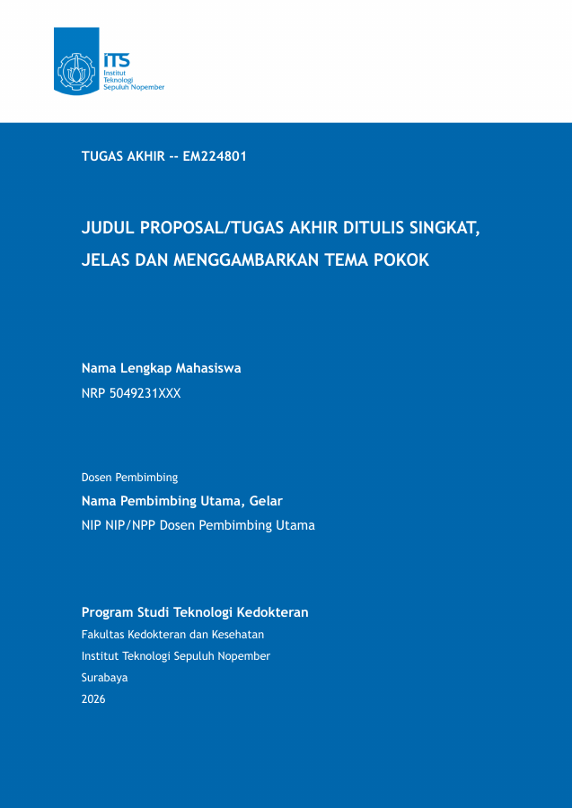

# Skill Tugas Akhir Teknologi Kedokteran ITS

Skill AI untuk menyusun proposal dan buku tugas akhir Teknologi Kedokteran ITS dari folder kerja sendiri. Skill menyalin [template LaTeX](./skills/tugas-akhir/template/) setelah pengguna memberi izin, membantu menulis berdasarkan data penelitian, lalu memeriksa hasil kompilasi PDF. Tidak perlu clone repo ini untuk mulai menulis.

## Pratinjau template



Gambar ini contoh sampul `sempro.tex`, bukan pratinjau langsung naskah pengguna. Judul, identitas, dan pembimbing pada gambar masih berupa data contoh.

## Instalasi

Pasang skill dari fork repo ini melalui [CLI skills](https://github.com/vercel-labs/skills). Perintah berikut memasang skill secara global agar bisa dipakai dari folder kerja mana pun:

```bash
bunx skills add nashirabbash/template-LaTeX-TA-teknologi-kedokteran-its-2026 --skill tugas-akhir -g
```

Tanpa `-g`, skill hanya dipasang untuk proyek saat ini. Instalasi tidak langsung mengisi folder kerja; agent menyalin template hanya ketika diminta dan setelah mendapat izin. Untuk menghasilkan PDF, komputer juga perlu distribusi TeX yang menyediakan `latexmk`, `xelatex`, `fontspec`, `biber`, `biblatex-apa`, dan `txfonts`. Berkas Times New Roman untuk isi dan Trebuchet MS untuk sampul sudah tersedia dalam folder `fonts/` proyek.

## Contoh pemakaian

Buka folder kerja kosong di agent yang mendukung pemanggilan skill dengan garis miring, lalu ketik:

> /tugas-akhir Buat proyek TA di folder ini.

Agent menunjukkan lokasi tujuan dan meminta izin sebelum menyalin berkas. Jika folder kerja sudah berisi berkas lain, pilih subfolder baru yang kosong agar tidak ada berkas tertimpa. Setelah proyek dibuat, gunakan skill yang sama untuk menulis atau memeriksa:

> /tugas-akhir Bantu tulis Bab 1 berdasarkan rumusan masalah dan sumber yang saya berikan. Target saya proposal.

> /tugas-akhir Periksa PDF proposal saya.

Sesudah satu permintaan penulisan selesai, agent membangun PDF dokumen target dan melaporkan hasil serta lokasi berkas untuk dibuka. Bila berkas yang dipakai bersama berubah tanpa target yang disebut, agent membangun kedua dokumen. Skill tidak membuka PDF secara otomatis.

Proyek hasil salinan memuat `sempro.tex` (proposal Bab 1–3), `buku-ta.tex` (buku Bab 1–5), serta `main.tex` (alternatif proposal). Bab 1–3 dipakai bersama sehingga perubahan di sana memengaruhi kedua dokumen. Isi identitas dan pembimbing di `pustaka/variables.tex`, naskah di `bab/` dan `abstrak/`, serta sumber sitasi di `pustaka/pustaka.bib`. Ganti seluruh data contoh; periksa tulisan AI terhadap data penelitian, sumber asli, ketentuan resmi prodi, dan arahan pembimbing sebelum menyerahkan naskah.

## Bangun PDF secara manual

Dari folder proyek hasil salinan, jalankan perintah berikut bila ingin membangun PDF tanpa agent:

```bash
latexmk -xelatex -halt-on-error sempro.tex
latexmk -xelatex -halt-on-error buku-ta.tex
```

Teks isi memakai Times New Roman; sampul memakai Trebuchet MS. Kedua font dibaca langsung dari berkas `.ttf` di folder `fonts/`, sehingga pengguna tidak perlu memasang font pada sistem. Hak cipta font tetap milik pemegang hak masing-masing; baca [EULA font](./skills/tugas-akhir/template/fonts/corefonts-eula.html). Di Overleaf, unggah seluruh isi proyek dan pilih XeLaTeX. Jika `latexmk` belum tersedia, jalankan `xelatex -halt-on-error sempro.tex`, `biber sempro`, lalu `xelatex -halt-on-error sempro.tex` dua kali; ganti `sempro` dengan `buku-ta` untuk buku. Perubahan format template tercatat di [CHANGELOG.md](./CHANGELOG.md). Lisensi kode: [MIT](./LICENSE); font tunduk pada EULA Microsoft Core Fonts.
