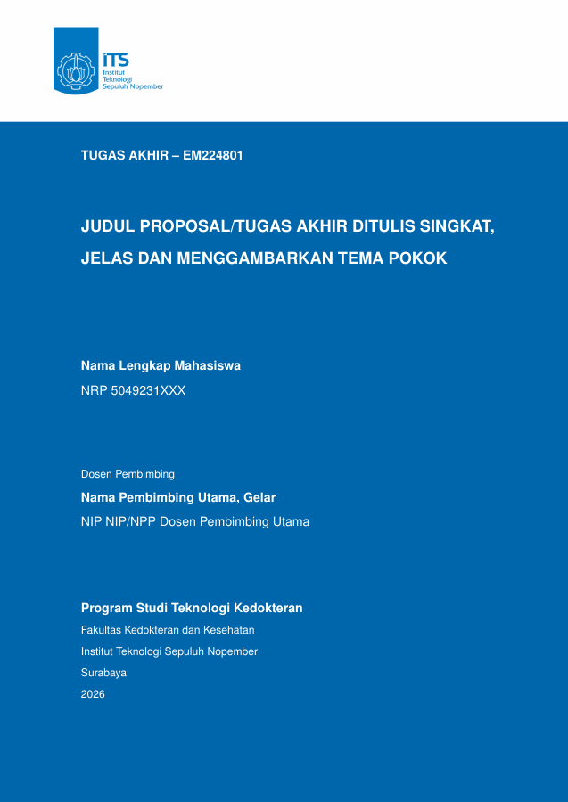

# Template LaTeX Proposal & Buku Tugas Akhir — Teknologi Kedokteran ITS 2026

[](https://github.com/Aisarsyb/template-LaTeX-TA-teknologi-kedokteran-its-2026)
[](https://www.latex-project.org/)
[](https://www.its.ac.id/)
[](https://www.its.ac.id/)
[-blue.svg)](https://www.its.ac.id/)
[](./LICENSE)

Template LaTeX untuk menyusun proposal seminar proposal dan buku tugas akhir Program Studi Teknologi Kedokteran ITS. Isi Bab 1–3 dipakai bersama agar naskah proposal dapat dilanjutkan menjadi buku tugas akhir tanpa menyalin berkas. Contoh identitas dan isi masih perlu diganti sebelum dipakai. Perubahan format terbaru tercatat di [CHANGELOG.md](./CHANGELOG.md).

## Pratinjau sampul proposal



## Pilih dokumen

| Tipe Dokumen | File Utama (*Master*) | Cakupan Bab & Halaman |
| :--- | :--- | :--- |
| **Proposal Sempro** | [`sempro.tex`](./sempro.tex) atau [`main.tex`](./main.tex) | Bab 1–3 dan daftar pustaka |
| **Buku Tugas Akhir** | [`buku-ta.tex`](./buku-ta.tex) | Bab 1–5, kata pengantar, pernyataan orisinalitas, dan biodata |

Identitas, judul, dan nama penguji diatur di [`pustaka/variables.tex`](./pustaka/variables.tex). Sampul bahasa Indonesia berbagi konten di [`sampul/konten-id.tex`](./sampul/konten-id.tex); versi Inggris memakai [`sampul/konten-en.tex`](./sampul/konten-en.tex).

---

## Format yang tersedia

Template memakai halaman awal bernomor Romawi dan isi bernomor Arab. Bab, caption, paragraf, serta daftar memakai aturan bersama di [`pustaka/gaya-teks.tex`](./pustaka/gaya-teks.tex). Isi paragraf 12 pt dengan inden dan jarak setelah paragraf; daftar bernomor dan berpoin rapat antarbutir, tanpa jarak sebelum daftar. Daftar isi, gambar, tabel, dan simbol diatur di [`pustaka/daftar-awal.tex`](./pustaka/daftar-awal.tex). Font `txfonts` menyerupai Times, tetapi bukan berkas font Times New Roman.

Sitasi memakai `biblatex` gaya APA dengan `biber`. Format ini disusun sebagai template; periksa kembali ketentuan resmi program studi dan pembimbing sebelum menyerahkan naskah.

---

## Berkas utama

| Lokasi | Fungsi |
| :--- | :--- |
| `main.tex`, `sempro.tex` | Dokumen proposal Bab 1–3 |
| `buku-ta.tex` | Buku tugas akhir Bab 1–5 |
| `pustaka/variables.tex` | Identitas, judul, dan nama pembimbing/penguji |
| `pustaka/gaya-teks.tex` | Gaya heading, paragraf, daftar, dan caption |
| `pustaka/daftar-awal.tex` | Daftar isi, gambar, tabel, dan simbol |
| `abstrak/` | Abstrak Indonesia dan Inggris |
| `sampul/` | Sampul luar dan dalam |
| `bab/` | Isi Bab 1–5 |
| `lainnya/` | Lembar pengesahan dan halaman pelengkap |
| `pustaka/pustaka.bib` | Referensi untuk sitasi |

---

## Mulai memakai template

Kloning proyek terlebih dahulu:

```bash
git clone https://github.com/Aisarsyb/template-LaTeX-TA-teknologi-kedokteran-its-2026.git
cd template-LaTeX-TA-teknologi-kedokteran-its-2026
```

Siapkan distribusi TeX yang memiliki `pdflatex`, `biber`, serta paket yang dipakai dokumen (`biblatex-apa`, `txfonts`, `tabularx`, dan paket LaTeX standar). Dari direktori proyek, ubah data di [`pustaka/variables.tex`](./pustaka/variables.tex): `\name`, `\nrp`, `\advisor`, `\coadvisor`, `\tatitle`, `\engtatitle`, dan data NIP/penguji sesuai kebutuhan. Definisi variabel berbentuk `\newcommand{\name}{Nama Lengkap Mahasiswa}`; ganti isi dalam kurung kurawal kedua, bukan nama perintahnya.

Isi abstrak pada [`abstrak/`](./abstrak/), Bab 1–5 pada [`bab/`](./bab/), lalu masukkan sumber rujukan ke [`pustaka/pustaka.bib`](./pustaka/pustaka.bib). Sitasi memakai `\textcite{kunci_sitasi}` atau `\parencite{kunci_sitasi}`. Tabel identitas abstrak saat ini memuat teks contoh “Nama Pembimbing dan Gelar” / “Advisor Name and Title” secara langsung; ganti di masing-masing berkas abstrak bila sudah diketahui.

Untuk menghasilkan proposal, jalankan:

```bash
pdflatex -halt-on-error sempro.tex
biber sempro
pdflatex -halt-on-error sempro.tex
pdflatex -halt-on-error sempro.tex
```

Hasilnya `sempro.pdf`. Untuk buku tugas akhir, gunakan urutan sama dengan mengganti `sempro` menjadi `buku-ta`. `main.tex` juga menghasilkan proposal; gunakan `biber main` bila memilih berkas itu. Jalankan perintah di direktori proyek supaya jalur `\input` dan gambar ditemukan.

---

## Pilihan penyunting

Di Overleaf, unggah seluruh proyek, pilih berkas utama `sempro.tex` atau `buku-ta.tex`, dan gunakan compiler pdfLaTeX. Di VS Code, pasang LaTeX Workshop dan pilih berkas utama sebelum membangun; pastikan proses `biber` dijalankan setelah lintasan pertama `pdflatex`. Workflow [CI](./.github/workflows/ci.yaml) membangun `sempro.tex` dan `buku-ta.tex`.

## Menyesuaikan format

Heading 1–4, caption, serta token `\paragraphtextstyle` dan `\listtextstyle` berada di [`pustaka/gaya-teks.tex`](./pustaka/gaya-teks.tex). Token paragraf digunakan pada abstrak, bab, dan daftar pustaka. Token daftar berlaku global: antarbutir tanpa jarak tambahan, tanpa jarak sebelum daftar, dan menyisakan jarak setelah daftar. Daftar isi, daftar gambar, daftar tabel, dan daftar simbol bersumber dari [`pustaka/daftar-awal.tex`](./pustaka/daftar-awal.tex). Untuk memperbarui tampilan, ubah berkas bersama, bukan salinan aturan di tiap bab.


Untuk menyisipkan gambar, simpan berkas di `gambar/`, lalu gunakan `\includegraphics` dalam lingkungan `figure` dan beri `\caption` agar masuk daftar gambar. Istilah asing dapat ditulis dengan `\emph{istilah}`.

## Berkontribusi

Ubah isi pada berkas bab atau abstrak yang terkait. Jika mengubah aturan format bersama, periksa hasil PDF proposal dan buku tugas akhir, lalu perbarui [CHANGELOG.md](./CHANGELOG.md) agar perubahan dapat ditelusuri.

## Lisensi

Berkas template ini dilisensikan di bawah [MIT License](./LICENSE). Silakan gunakan, bagikan, dan kembangkan untuk kebutuhan akademik mahasiswa Departemen Teknologi Kedokteran ITS.
